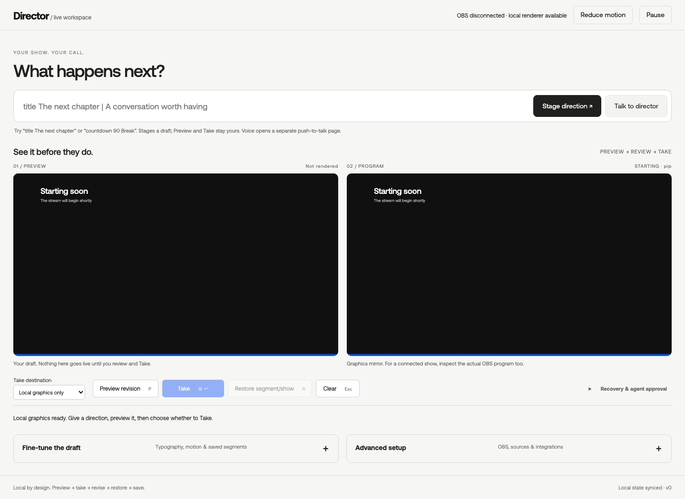

# Agentic Streamer

A solo streamer's visual producer: direct a change, inspect the preview, then deliberately choose what goes live.

## In 30 seconds

This is a local prototype with an account-free judge rehearsal. You can inspect its source and run the simulated directing path before connecting an account, microphone or native OBS. Setup time depends on downloading dependencies and pinned upstream source; it is not a 30-second install.

The source includes validated data-only compositions, camera layouts and undo, show recovery, operator-selected materials and fixed audience requests. Native Direct/Audience sections and Advanced setup live in the OBS fork. CEF browser sources are build-OFF and runtime-OFF by default; browser docks are excluded. The full spoken, native and live-chat journey remains unverified. The experimental API voice route is separately opt-in and billed; it is not a requirement for the account-free quickstart.

<!-- Demo GIF slot: MAIN adds a real, reviewed capture from the final functioning build here. No replacement video or GIF is supplied by this documentation package. -->

The project is [Morkeeth/agentic-obs](https://github.com/Morkeeth/agentic-obs). Its curated public history preserves upstream attribution without importing private development sessions. Exact pins are in the source manifest. Read the acceptance limits below before enabling anything on a real show.



## Choose your starting point

**Try the local web director first.** No OBS, account or microphone is needed to
compose a title, Preview it, then Take to the local graphics mirror. After the
version check and venv install below, run:

```sh
. .venv/bin/activate
python3 director_server.py --port 8880
```

Open **http://127.0.0.1:8880**. Type `title My next chapter`, choose **Stage
direction**, then **Preview revision**. Inspect the draft before **Take**.
This is a local graphics rehearsal, not a connected stream. **Fine-tune the
draft** holds manual typography and motion; **Advanced setup** holds OBS and
integrations. Neither connects itself. **Talk to director** opens a separate
push-to-talk page; cloud voice requires deliberate server/key setup and a held
mic gesture. The text path needs neither.

**Use real OBS only after the local rehearsal.** There is no downloadable native
installer in this source package. Follow [SOURCE-BUILD.md](SOURCE-BUILD.md) for
the pinned OBS fork and build prerequisites, then connect/setup/arm explicitly
under Advanced setup. Leave all outputs off until the actual native preview is
verified. The account-free test route below validates source and simulation;
it does not certify a native install or stream.

## Account-free setup and rehearsal

Use **Python 3.12** and **Node 22 or newer**, plus Git (no browser for rehearsal).
Before installing, run this one-line check in the same terminal. It stops on an
old Node executable instead of letting you discover it after the install:

```sh
python3.12 --version && node -e 'require("node:assert")(Number(process.versions.node.split(".")[0]) >= 22, "Node 22+ required; fix PATH"); console.log("Node", process.version, process.execPath)'
```

If it fails, select your installed Python 3.12 and Node 22+ on `PATH`, then repeat
the check. The printed Node path is the one the rehearsal will use. Do not use
Apple’s `/usr/bin/python3` developer-tools shim for this setup.

From this source checkout, create **and activate** the isolated venv. Activation
also keeps executable fixture scripts using `#!/usr/bin/env python3` on the same
venv Python, rather than the system shim:

```sh
python3.12 -m venv .venv
. .venv/bin/activate
python3 -c 'import sys; assert sys.prefix != sys.base_prefix and sys.version_info[:2] == (3, 12), "Activate the Python 3.12 venv first"; print("Venv Python:", sys.executable)'
env -i PATH=/usr/bin:/bin:/opt/homebrew/bin PIP_CONFIG_FILE=/dev/null .venv/bin/python -m pip --disable-pip-version-check --no-input --keyring-provider disabled install --index-url https://pypi.org/simple --only-binary=:all: --no-cache-dir -r requirements.txt -r requirements-live.txt
.venv/bin/python tools/check_package.py --history
.venv/bin/python tools/bootstrap_fork.py --destination fork-src --fetch-public
LANG=en_US.UTF-8 .venv/bin/python tools/rehearse.py --node "$(node -p 'process.execPath')"
```

The pip command installs only into this new venv from public PyPI, without user
pip configuration, keyring credentials or a development dependency loan. The
bootstrap fetches only pinned official OBS/browser public source, applies both
license-preserving patches and verifies actual source contents/modes. It does not
build, launch, install native dependencies or fetch unreachable custom commits.
For an account-free **local object-store rehearsal**, replace only the bootstrap
line above with this explicit alternative (the destination must still be new):

```sh
.venv/bin/python tools/bootstrap_fork.py --destination fork-src --obs-objects /explicit/obs-object-store --browser-objects /explicit/browser-object-store
```

Local clone/object-store proof is not an anonymous public remote proof. That
requires a later anonymous clone of the maintainer-published branch.

The rehearsal runs unchanged original70/native15 checks, expanded Python tests,
the bundle-checker boundary tests and all Node source checks. It then runs
**simulated** 30 scene cycles, 10 author/revise journeys and three persistent-mode
checks, plus legacy local HTTP/SSE rehearsal. The reconstructed fixed WebKit page
is required input to its injected Node check. Compiled Qt Widgets, native bundle
identity and actual bundle-closure acceptance are explicitly **NOT RUN** here;
those require a later native build. No real OBS/Twitch, model, microphone, permission,
output or renderer is used. ACKs/rAF are not GPU pixel proof.

For later local operator use, start the controller in the foreground:

```sh
.venv/bin/python director_server.py --port 8880
```

It reports its PID. Connect, bind/setup and arm owned OBS explicitly in the UI;
there is no auto-connect or arm. Leave stream/recording/virtual camera off for
rehearsal. See [testing](TESTING.md) and [native source/build](SOURCE-BUILD.md).

The runner enforces a standard UTF-8 locale: `en_US.UTF-8` on macOS and
`C.UTF-8` elsewhere. It normalizes missing `LANG` and clears `LC_ALL`/`LC_CTYPE`
inside the packaging test process, without changing application environment
permissions. It checks Node 22+ before running tests; `--node` selects an explicit
installed executable and avoids a different Node version on a stripped PATH.
The missing-LANG boundary can be checked without services or models:

```sh
env -u LANG .venv/bin/python tools/rehearse.py --locale-check
```

## Optional native OBS checks

The account-free judge path does not require an OBS build. With the current
inventory it reports **364 run, 6 skipped (native prerequisites absent)**: five
parser tests and one class-level loopback prerequisite skip. That class contains
three socket assertions, none exercised when its setup is skipped. The separately
listed compiled bundle-identity check is also NOT RUN. Skips do not prove native
safety, renderer pixels, audio-device absence or crash recovery. Every reason is
printed and retained in the rehearsal JSON. Python, Node and simulated replay
checks still run; missing native prerequisites never count as native passes.

To opt into these checks, deliberately fetch and build native prerequisites using
[native source/build](SOURCE-BUILD.md). Do this in a separate native checkout or
under the normal build gate; no native build is needed for judge rehearsal.
Do not recursively reset the patched browser submodule. Fetch only the public
obs-websocket gitlink, then apply the supplied local-only listener repair:

```sh
git -C fork-src submodule update --init -- plugins/obs-websocket
git -C fork-src/plugins/obs-websocket apply --check "$PWD/obs-websocket-loopback.patch"
git -C fork-src/plugins/obs-websocket apply "$PWD/obs-websocket-loopback.patch"
```

The baseline Git object required by the socket test is
`e28f84975984340e84fc4879cfc05741cc0afde1`. Obtain websocketpp and standalone Asio
headers from the pinned OBS dependency bundle prepared by the native CMake preset;
`OBS_WEBSOCKET_HEADERS` must name its include directory containing both
`websocketpp/server.hpp` and `asio.hpp`. A working `clang++` is also required.
Do not substitute a system header version and call it the pinned native build.

For the parser tests, build the OBS `libobs` target from that reconstructed native
source and its declared dependencies, following SOURCE-BUILD.md. Compile
`tools/check_obs_ini.c` against that build's libobs headers and library. On macOS,
after setting `OBS_FRAMEWORKS` to the directory containing that build's
`libobs.framework`, the parser-only utility can be built with:

```sh
mkdir -p .native-checks
clang -I fork-src/libobs -F "$OBS_FRAMEWORKS" tools/check_obs_ini.c -framework libobs -Wl,-rpath,"$OBS_FRAMEWORKS" -o .native-checks/check_obs_ini
export OBS_INI_CHECKER="$PWD/.native-checks/check_obs_ini"
```

On other platforms link the equivalent built libobs development library. This
utility only calls the actual INI/JSON parsers: it never calls `obs_startup`, loads
capture plugins or launches OBS. Native dependency locations are platform-specific;
the optional build commands are instructions, not evidence they ran in the judge
path. Set `OBS_WEBSOCKET_HEADERS` to the pinned include directory, then run:

```sh
.venv/bin/python -m unittest -v test_obs_fixture_ini test_obs_loopback
```

Missing checker/source/header/compiler prerequisites produce explicit skips.
With those prerequisites present, parser rejection, compiler errors and socket
assertions remain failures; no broad exception handler turns them into skips.
Never launch OBS or enable a device to make a source-check result green. Do not
rerun the source-only bootstrap integrity check on a checkout whose native
submodule you deliberately patched; keep native checks separate from the frozen
source reconstruction proof.

## Human and model boundaries

Only the operator connects, sets up or arms native control. Preview uses the
inactive bank; renderer freshness and human pixel review are different gates.
Manual Take remains deliberate. Agent Take requires exact human approval of its
reviewed revision. No arbitrary OBS RPC or output-control tool is exposed.
The trusted external Codex client is not claimed globally tool-isolated.

The native managed Codex App Server uses subscription authentication and system
WebKit WebRTC, with no API-key/paid-provider fallback. General creative speech and
ordinary text directing remain implemented; actual account/audio acceptance is
pending. The obsolete PCM preparation code is test-only, not a working managed
voice route. Microphone and spoken-input opt-ins default off. **Every exact spoken
Take/approve also requires a fresh local human click on the existing inspected-
preview checkbox**, binding its complete preview/version/current voice session
for one use, at most eight seconds. Speech/MCP/model cannot arm it. Working,
stale state, mute, stop, auth/session changes or expiry retire it; consent is
consumed before send and never automatically replayed. ASR `role=user` is input,
not person identity: model TTS can re-enter a microphone. Fully hands-free
privileged authorization remains **OPEN**. Manual Take remains usable during
idle active voice. Stop retires the peer and owned App Server; physical WebKit
capture/playback teardown is asynchronous and unverified.

Viewer text is ephemeral inert operator-only text, never model/render/export
content. An operator accepts one exact queued request as one fixed intent, once.
Default-OFF numeric voting changes only counters for fixed reviewed choices;
viewers never choose/take a scene. The dedicated read-chat launcher adds no
rewards, native Twitch Polls API or scopes. Original identity/client/expiry/session
validation is retained. Real expanded live-chat acceptance remains unverified.

Material reads require explicit human selection. HTTPS page registration is
operator-only; staging does not rewrite the active bank or grant Take approval.
Viewer URLs/text never become catalogs, prompts or arbitrary overlays.

## Attribution and license

Transport rebuilt in this Codex thread on 29 Oct from a written spec; an earlier prototype existed, and the OBS director core was built in other Codex threads.

Expanded rebuilding and source packaging were completed in this clean Codex
build thread. Earlier branding/isolation spike work is preserved, not relabelled.
Exact source pins, binary-safe patches, file modes and the hashed test-location
adjustment and strengthened immutable-base test provenance are in [the manifest](packaging/source-manifest.json). See the
[license map](LICENSE-MAP.md): Python MIT is not a blanket license for GPL OBS or
browser source. No private sessions/config/auth, built binaries or raw evidence
are included.

## Explicit push-to-talk API director

The local `/voice.html` route adds hold-to-talk input and spoken guidance using
OpenAI `gpt-realtime-2.1`. It is disabled unless the server is explicitly started
with `--realtime-voice` and its own server-side `OPENAI_API_KEY`. This is a billed
API route, not the existing managed subscription authentication. The model can
stage validated visuals but cannot approve/Take, arm OBS or control outputs.
See [local implementation and fixture checks](REALTIME-VOICE.md).

Own audio-file protocol and capture-lifecycle tests pass without a microphone;
they use a simulated API peer. Live provider, physical audio, browser and native
acceptance remain unverified. No API key is packaged or discovered automatically.
